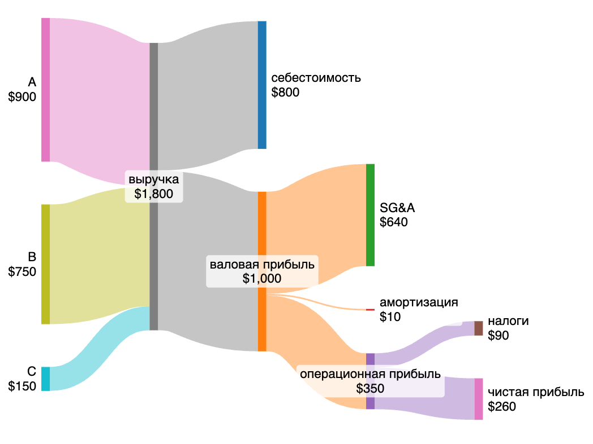

# Диаграмма SankeyMATIC — скилл для агентов

Превращает текст, таблицу или описание словами в корректную диаграмму
[SankeyMATIC](https://sankeymatic.com/build/): агент задаёт четыре вопроса с
готовыми вариантами, строит потоки, проверяет, что каждый промежуточный узел
сходится, валидирует синтаксис и отдаёт `.txt` плюс ссылку, которая сразу
открывает готовую диаграмму.



*Так выглядит результат для такого текста:*

> Сделай диаграмму Sankey: выручка 1800, из них подразделение A — 900,
> B — 750, C — 150; себестоимость 800, валовая прибыль 1000; SG&A 640,
> амортизация 10, операционная прибыль 350; налоги 90, чистая прибыль 260.

*Пять колонок, суммы под именами, ничего не пересекается.*

## Что вы получите

- четыре вопроса, у каждого есть значение по умолчанию: размер меток 18, высота
  узлов 20, расстояние между узлами 30, тема Categories (варианты: Tableau10,
  Dark, Varied);
- один дополнительный вопрос про единицы измерения, только если из текста они не
  ясны;
- подписи переносятся по словам, а полотно само подстраивается под их длину —
  длинные русские названия больше не налезают на соседние колонки;
- сумма стоит под именем, а не в одной строке с ним;
- проверенный `<slug>.txt`, который загружается через **Load from file**;
- ссылку, которая открывает диаграмму со всеми настройками;
- по желанию — локальный предпросмотр на `127.0.0.1`, без публичной ссылки.

## Требования

- Агент с поддержкой Agent Skills: OpenCode, Claude Code, OpenAI Codex или
  VS Code Copilot. Проверено только в OpenCode 2.x.
- Node.js 20 или новее для вспомогательных скриптов. Зависимостей npm нет.
- Интернет для ссылки и для первого запуска локального предпросмотра.

## Установка

Дайте агенту одну строку:

> Установи скилл из https://github.com/teterkin/sankeymatic в каталог скиллов
> своего агента под именем `sankeymatic`.

Или клонируйте вручную:

| Агент | Каталог |
| --- | --- |
| OpenCode | `~/.config/opencode/skills/sankeymatic` (в старой раскладке — `skill/`) |
| Claude Code | `~/.claude/skills/sankeymatic` |
| OpenAI Codex | `~/.agents/skills/sankeymatic` |
| VS Code Copilot | `~/.copilot/skills/sankeymatic` или `.github/skills/sankeymatic` в проекте |

```sh
SKILL_DIR=~/.config/opencode/skills/sankeymatic   # подставьте каталог своего агента
git clone https://github.com/teterkin/sankeymatic.git "$SKILL_DIR"
```

Каталог должен называться `sankeymatic`: стандарт Agent Skills требует, чтобы
`name` во frontmatter совпадал с именем каталога. Перезагрузите агента — в
OpenCode это `/reload`; в остальных скилл подхватывается сразу или после
перезапуска (не тестировалось).

### Обновление

```sh
SKILL_DIR=~/.config/opencode/skills/sankeymatic   # ваш каталог
git -C "$SKILL_DIR" pull --ff-only
cat "$SKILL_DIR/VERSION"
```

`pull --ff-only` не перезаписывает локальные правки: если они есть, команда
остановится с ошибкой. После обновления перезагрузите агента (`/reload`).

### Удаление

Удаляет весь клонированный каталог вместе с локальными правками — это не
«выключить скилл», а стереть его.

```sh
SKILL_DIR=~/.config/opencode/skills/sankeymatic   # ваш каталог
rm -rf -- "${SKILL_DIR:?задайте SKILL_DIR}"
```

## Агенты без скиллов

ChatGPT, Gemini, Cursor rules: отдайте тело `SKILL.md` как инструкцию или
сослайтесь на файл в `AGENTS.md`/правилах. Скрипты запускаются вручную из
каталога скилла:

```sh
node scripts/layout.mjs диаграмма.txt --in-place
node scripts/validate.mjs диаграмма.txt
node scripts/link.mjs диаграмма.txt
```

## Использование

Спросите обычными словами и вставьте данные:

> Сделай диаграмму Sankey: выручка 1800, из них подразделение A — 900,
> B — 750, C — 150; себестоимость 800, валовая прибыль 1000; SG&A 640,
> амортизация 10, операционная прибыль 350; налоги 90, чистая прибыль 260.

Агент задаст четыре вопроса, затем вернёт исходник, ссылку и тот же текст в
блоке кода для вставки в поле Inputs.

Полный пример лежит в
[`tests/fixtures/pl-1800.expected.txt`](tests/fixtures/pl-1800.expected.txt),
исходный текст — в
[`tests/fixtures/pl-1800.md`](tests/fixtures/pl-1800.md).

## Локальный предпросмотр

```sh
node scripts/local.mjs путь/к/диаграмме.txt --open
```

Скрипт скачивает закреплённую копию сборки SankeyMATIC (около 750 КБ, с
проверкой контрольных сумм) в `~/.cache/sankeymatic-skill/<пин>/`, заменяет два
CDN-тега на локальные файлы, поднимает сервер на `127.0.0.1` и печатает URL.
Дальше всё работает офлайн. `node scripts/local.mjs --check` проверяет кэш без
запуска сервера и без сети: ничего не скачивает, а при неполном кэше выходит с
кодом 2.

## Приватность

- Ничего не загружается на сервер. Ссылка несёт диаграмму в payload `?i=`;
  любой, у кого есть URL, её увидит.
- Локальный предпросмотр не обращается к sankeymatic.com: при первом запуске
  скачиваются только закреплённые файлы, а сама диаграмма остаётся в URL.
- Для финансовых и других приватных данных используйте `--local`.

## Ограничения

- Локального рендеринга нет: PNG и SVG экспортируются со страницы диаграммы.
- SankeyMATIC не принимает циклы, потоки узла в себя, нулевые и отрицательные
  суммы; валидатор тоже.
- Ссылке нужен интернет, локальному предпросмотру — Node и браузер.

## Проверки

```sh
node --test scripts/*.test.mjs
node scripts/layout.mjs путь/к/диаграмме.txt --in-place
node scripts/validate.mjs путь/к/диаграмме.txt
node scripts/link.mjs --check '<ссылка>' --expect путь/к/диаграмме.txt
node scripts/local.mjs --check
```

Ссылка переносит диаграмму в `?i=` и не имеет контрольной суммы: один
потерянный или лишний символ превращает payload в мусор, а сайт молча рисует
свой пример Wages/Budget. `--check` распаковывает ссылку, считает узлы и
потоки и сверяет текст с файлом; `--expect` необязателен.

## Структура проекта

```
SKILL.md                 инструкция, которую загружает агент
references/              моделирование, синтаксис и палитры
scripts/                 валидатор, сборка ссылки, локальный предпросмотр, тесты
tests/fixtures/          пример P&L и эталонный вывод
docs/prd/                подтверждённый PRD
docs/images/             пример готовой диаграммы
NOTICE                   лицензии и атрибуция третьих сторон
```

## Лицензия

Сам скилл — MIT, см. [LICENSE](LICENSE). Текст лицензии оставлен на английском
дословно, как требует MIT. Третьи стороны (SankeyMATIC, d3, canvg, lz-string)
описаны в [NOTICE](NOTICE). Проект не связан с SankeyMATIC и не получал
официального одобрения её авторов.
